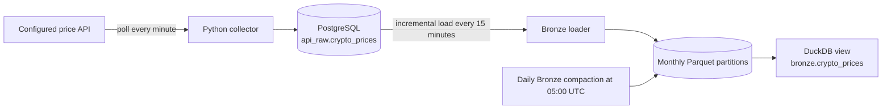

# Crypto Prices Lakehouse

A personal data engineering project focused on designing and building a small lakehouse pipeline while working toward a Mid-Level Data Engineer role.

The current workflow collects crypto price snapshots from the configured API, stores them in PostgreSQL, and incrementally appends them to monthly Parquet partitions in Bronze. The collector requests Bitcoin, Ethereum, Solana, and Toncoin prices in USD and EUR.

## Architecture



| Component | Responsibility |
| --- | --- |
| `src/ingest_crypto_prices_to_postgres.py` | Polls the configured price API once per minute and inserts the current snapshot into PostgreSQL. |
| `src/load_bronze_crypto_prices.py` | Loads rows beyond the current `price_id` watermark and appends Parquet files every 15 minutes. |
| `src/compact_bronze.py` | Compacts files within each monthly Bronze partition once a day at 05:00 UTC. |
| DuckDB | Exposes the Parquet data as the `bronze.crypto_prices` view. |
| `sql/maintenance_crypto_prices.sql` | Refreshes PostgreSQL planner statistics with `ANALYZE`. |

## Design

- `price_id` tracks incremental progress from PostgreSQL to Bronze.
- `last_updated_at` determines the monthly `period` partition and filename time range. Historical rows with a null value fall back to `fetched_at`.
- Bronze writes append uniquely named files; compaction combines small files later.
- New Bronze rows include `_loaded_at` and `_source` metadata.
- Files use `part-<min_partition_time>-<max_partition_time>-<uuid>.parquet` names.
- A filesystem lock prevents the loader and compactor from modifying Bronze simultaneously.
- The loader creates or refreshes the `bronze.crypto_prices` view when it writes new rows; the view reads Parquet files and infers `period` from partition directories.

The collector writes directly to PostgreSQL. If an API or database request fails, that poll is logged and the next scheduled poll requests a new current snapshot. The collector does not fabricate or replay missed historical values.

## Setup

Run commands from the repository root.

### 1. PostgreSQL

As a PostgreSQL administrator, create the role and database, then initialize the raw table. Run the two SQL statements separately; use the same password in `.env`:

```sql
CREATE ROLE crypto_writer WITH LOGIN PASSWORD 'set-a-password';
CREATE DATABASE crypto_analytics OWNER crypto_writer;
```

```bash
psql -U postgres -d crypto_analytics -f sql/01_init_postgres.sql
```

### 2. Python environment

```bash
uv sync
```

This creates `.venv` from `pyproject.toml` and `uv.lock`. The default `notebooks` group includes JupyterLab and the data-analysis libraries. To enable the Prophet forecast cells, install the optional forecast dependencies:

```bash
uv sync --extra forecast
```

Register the project environment as a Jupyter kernel and start JupyterLab:

```bash
uv run --extra forecast python -m ipykernel install --user --name lakehouse-project --display-name "Python (lakehouse-project)"
uv run --extra forecast jupyter lab
```

Choose the `Python (lakehouse-project)` kernel for the notebooks. If you do not need forecasting, omit `--extra forecast` from these commands. When enabling Prophet later, run `uv sync --extra forecast` from the repository root and restart the notebook kernel.

### 3. Configuration

```bash
cp .env.example .env
```

Set `DB_HOST`, `DB_PORT`, `DB_USER`, `DB_PASSWORD`, `DB_NAME`, `API_BASE_URL`, and `API_KEY` in `.env`. Use `crypto_writer` for `DB_USER`, `crypto_analytics` for `DB_NAME`, and the same password you set for the PostgreSQL role. The collector appends `/simple/price` to `API_BASE_URL` and sends `API_KEY` in the `x-cg-demo-api-key` header. `API_BASE_URL` should not include the endpoint path or a trailing slash. `LOG_LEVEL` is optional and defaults to `INFO`; keep `.env` and real credentials out of version control.

### 4. DuckDB

```bash
uv run python src/02_init_duckdb.py
uv run python src/03_init_duckdb_schemas.py
```

DuckDB is stored at `data/lakehouse.db`. Running `src/02_init_duckdb.py` from the repository root initializes the database and creates the layer directories `data/bronze/`, `data/silver/`, and `data/gold/` inside the repository. Bronze Parquet files are stored under `data/bronze/crypto_prices/`; the Silver and Gold directories are ready for later layers. The schema initialization script creates the DuckDB layer schemas. The `bronze.crypto_prices` view appears after a Bronze load writes rows.

## Run the pipeline

Start the collector and Bronze loader in separate terminals:

```bash
uv run python src/ingest_crypto_prices_to_postgres.py
```

```bash
uv run python src/load_bronze_crypto_prices.py
```

Start the daily compaction scheduler. It waits until the next 05:00 UTC run and stays active:

```bash
uv run python src/compact_bronze.py
```

The collector polls once per minute; change `POLL_INTERVAL_SECONDS` in the script if your API plan requires a slower cadence. Check your plan's request allowance before running it continuously.

The Bronze loader runs immediately at startup, then on 15-minute UTC boundaries. The compactor runs daily at 05:00 UTC; `compact_bronze()` performs a single run. Compaction rewrites Parquet files in Bronze.

The standalone scripts own their polling loops for now. If an orchestrator such as Airflow is introduced, call `fetch_and_insert()` or `load_bronze_crypto_prices()` once per task and let the orchestrator own the schedule.

## Logging and maintenance

Scripts log UTC timestamps to the terminal and to rotating files under `logs/`, including:

- `logs/ingest_crypto_prices_to_postgres.log`
- `logs/load_bronze_crypto_prices.log`
- `logs/compact_bronze.log`

Use `LOG_LEVEL=DEBUG` for more detail. Follow a running job with `tail -f logs/<script-name>.log`.

PostgreSQL autovacuum handles routine maintenance. To refresh planner statistics manually, run:

```bash
psql -U postgres -d crypto_analytics -v ON_ERROR_STOP=1 -f sql/maintenance_crypto_prices.sql
```

To rebuild the PostgreSQL index after monitoring indicates it is needed, run `sql/reindex_crypto_prices.sql`:

```bash
psql -U postgres -d crypto_analytics -v ON_ERROR_STOP=1 -f sql/reindex_crypto_prices.sql
```

The project currently focuses on one source and the Bronze layer.
